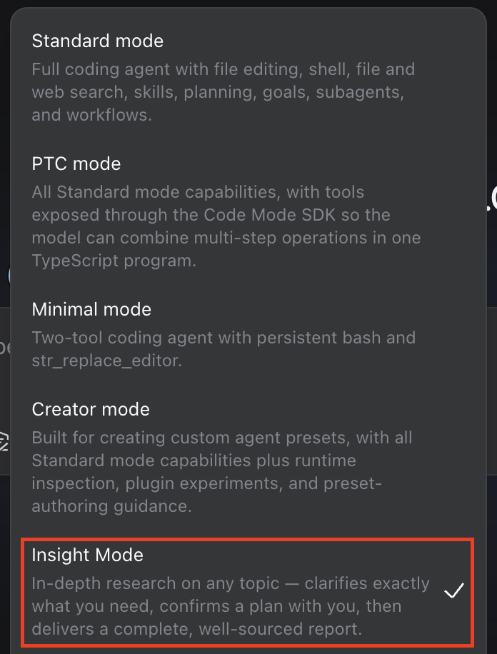
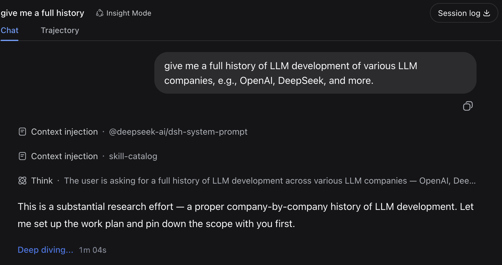
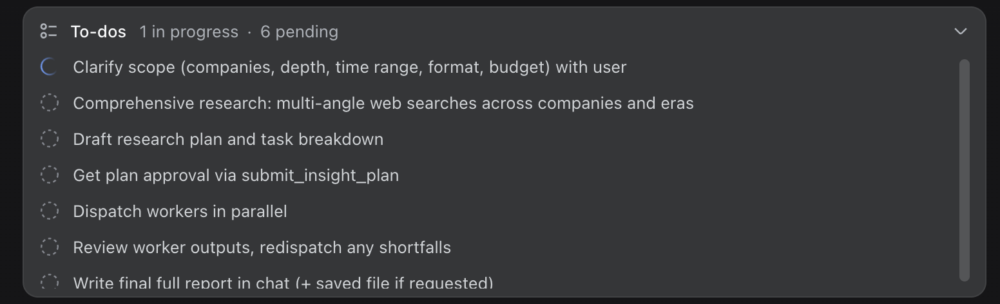
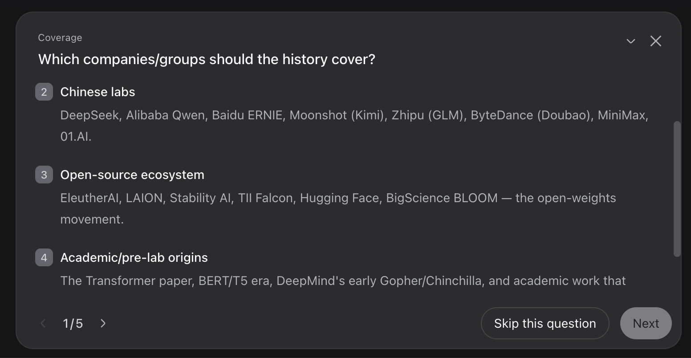
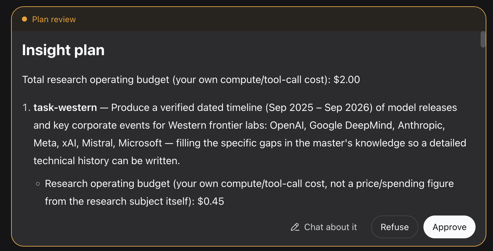
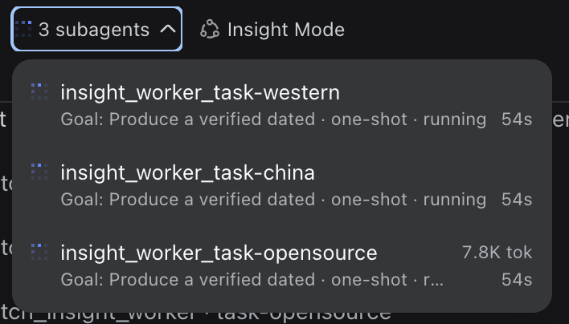
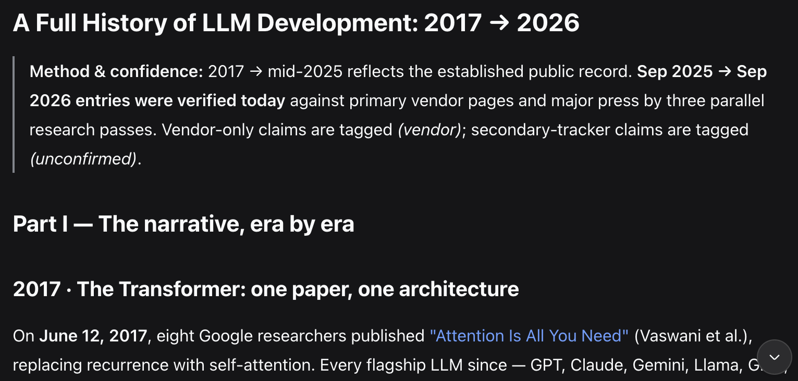

# DSH | dsh-plugin-insight-mode | Master/worker deep research with a human approval gate before any work starts

A single agent doing deep research has to context-switch between scoping, researching, and writing - all in one thread, with no checkpoint to catch a bad plan before it burns budget. Insight Mode splits that into a **master** that clarifies your request and proposes a task breakdown + budget for your approval, and independent **worker** subagents, dispatched only after you approve, that run in parallel and can't talk to you or spawn further workers.



## How it works

A real run - asking for a full history of LLM development:

**1. Receive the task** - does this need the full workflow, or a direct answer?



**2. List a todo checklist** up front, so progress is visible from the very start, not only once workers are dispatched:



**3. Clarify** - concrete questions, one at a time, each with a recommended default; can take several turns until the request is precise enough to act on:



**4. Comprehensive research** - the master does its own multi-angle `web_search` passes to work out the real research directions, technical approaches, and categories before drafting anything.

**5. Draft a plan and submit for approval** via `submit_insight_plan` - **this blocks on your approval**; Refuse sends feedback back for revision, so this can take a few rounds too:



**6. Dispatch workers in parallel** via `dispatch_insight_worker` - multiple calls in one step, so independent tasks genuinely run at once:



**7. Workers report back, master finalizes** - each worker self-assesses and returns; the master reviews every output itself (not just trusting "criteria met: true"), can redispatch a task with corrective guidance, and once everything's in, writes the full report directly into its closing message - never just a pointer to a file:



## How it integrates with DSH

A pure host-side plugin - no client code. It registers its own identity directly as DSH's `deployment:persona` prompt section (`ctx.systemPrompt.section()` - the same mechanism `@deepseek-ai/dsh-persona` itself uses), so installing this plugin is enough on its own; no separate persona to hand-assemble. It also mounts `submit_insight_plan` (the approval gate, same `ctx.userQuestions.ask()` primitive as `exit_plan_mode`) and `dispatch_insight_worker` (spawns an isolated `spawn` subagent per task via `ctx.subagents`). Workers can run on a separate model from the master, so master cost doesn't multiply across every dispatch - see Install.

## How this differs

A few research-oriented DSH plugins already exist - citation-integrity engines, an academic-paper workbench, a read-only code-project diagnostic preset. None combine a **domain-agnostic topic**, **true parallel multi-worker dispatch**, and a **human approval gate on the plan and budget before any work starts**. That combination is the actual point of difference, not a claim of deeper research than a domain-specialized tool.

## Install

```sh
dsh plugin --profile web add @gz2016/dsh-plugin-insight-mode
```

The plugin supplies its own persona (no persona text to copy or hand-assemble), but DSH still needs a concrete preset **directory** to select in the picker - presets are directory-discovered, not plugin-registered, so there's no code hook for a plugin to create one for you. This package ships a ready-to-use one (everything else Standard mode has - shell, fs, skills, planning, etc. - plus this plugin's own row, no separate persona row) - copy it into your preset root and restart:

```sh
cp -r ~/.dsh/profiles/web/node_modules/@gz2016/dsh-plugin-insight-mode/preset ~/.dsh/.agent-presets/insight
```

(Adjust the paths if you use a custom `$DSH_HOME` or profile name.) "Insight Mode" then appears in the preset picker.

## Known limitations

- The domain gate ("does this need the full workflow") is a persona instruction, not a code-enforced check - it can be misjudged.
- The operating budget is advisory: it rides in the worker's prompt as an instruction, and nothing aborts a worker mid-flight for exceeding it. Actual-spend reporting needs a separate cost-tracking plugin providing a `costForSession` service.
- Approved-plan and retry-count state is in-memory per process, not durable across a restart.

---
*Unofficial project, independently developed and maintained by a community member. Not affiliated with or endorsed by DeepSeek.*
